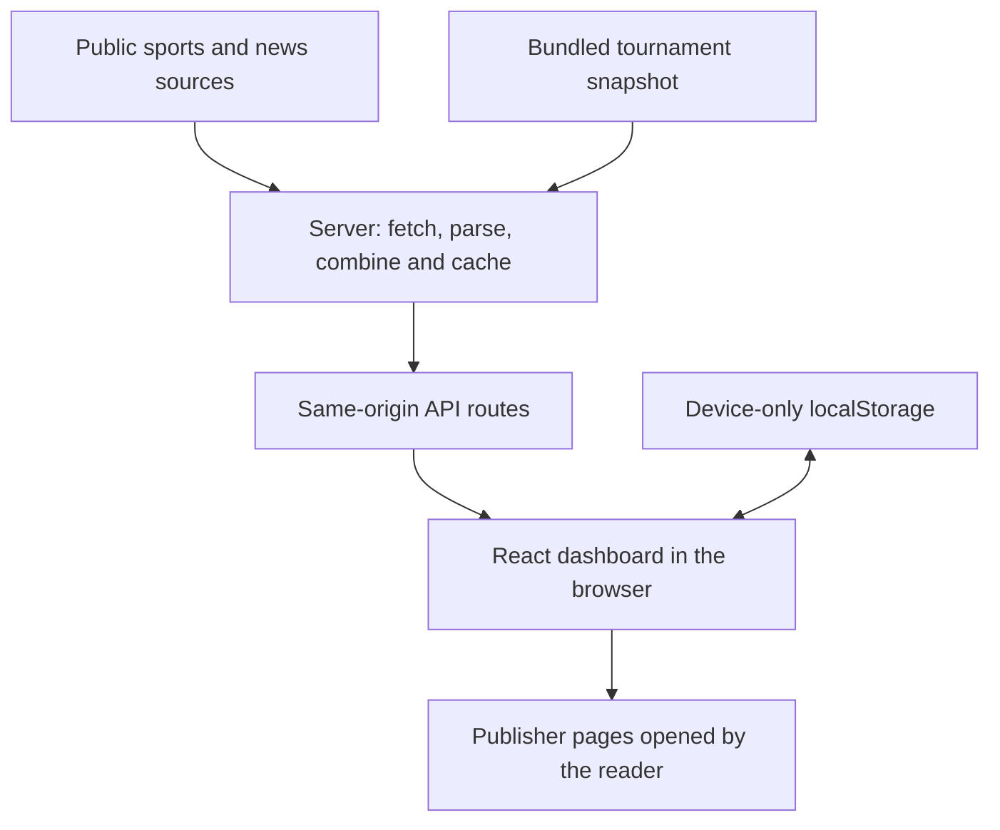
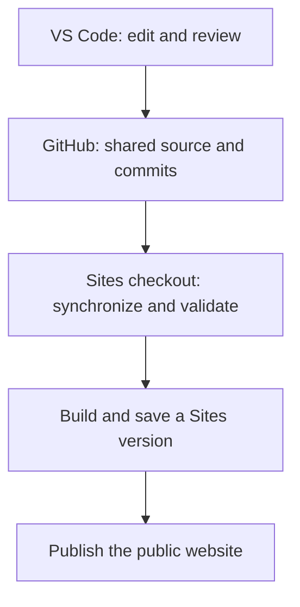

# Architecture overview

Wolves & Friends is a sports dashboard that brings public news, schedules, scores, odds, social posts, standings, and rosters into one page. It consists of a browser interface and a small server-side feed aggregator. There is no application database or user-account system.

This guide describes the implementation as of October 27, 2026. Start with the big picture, then use the file links to explore a feature.

## 1. The big picture

The browser asks **our own server** for public feeds. Team-specific news requests include the selected public team ID in the same-origin `/api/news` query; read and saved state are not sent. The server contacts ESPN, publishers, club websites, and Bluesky, then returns a common data format without forwarding visitor headers.

Headlines link to publishers rather than reproducing full articles. Deliberately opening a link takes the reader to that external site.

## 2. The main parts of the repository

| Part               | Responsibility                                                                            | Start here                                                                               |
| ------------------ | ----------------------------------------------------------------------------------------- | ---------------------------------------------------------------------------------------- |
| Page composition   | Holds page selection and assembles dashboard sections                                     | [app/page.tsx](app/page.tsx)                                                             |
| Feed lifecycle     | Requests feeds, manages feed responses and refreshes, and loads roster stats              | [hooks/use-dashboard-feeds.ts](hooks/use-dashboard-feeds.ts)                             |
| Shared page shell  | Imports styles and defines metadata and the mobile viewport                               | [app/layout.tsx](app/layout.tsx)                                                         |
| Presentation       | Responsive layout, colors, badges, spacing, and team themes                               | [app/globals.css](app/globals.css), [lib/teams/team-themes.ts](lib/teams/team-themes.ts) |
| Team configuration | One folder per team: identity, links, IDs, feed URLs, and team-specific behavior          | [lib/teams/](lib/teams/) (see [Team folders](#team-folders))                             |
| Dashboard logic    | Team/read/search selection, cached-data validation, and retired-team filtering            | [lib/dashboard/](lib/dashboard/)                                                         |
| Browser utilities  | Device storage, same-origin feed requests, score preferences, news windows, and scrolling | [lib/browser/](lib/browser/)                                                             |
| Feed endpoints     | Return public data to the page                                                            | [app/api](app/api)                                                                       |
| Feed adapters      | Convert each provider's JSON, RSS, HTML, or calendar into shared objects                  | [lib/feeds/](lib/feeds/) and its provider modules                                        |
| Reusable sections  | Game cards, calendar, standings/rosters, and logo groups                                  | [components](components)                                                                 |
| Images             | Local header and team logos                                                               | [public/logos](public/logos)                                                             |
| Hosting            | Build and serve the application through Sites                                             | [vite.config.ts](vite.config.ts), [build/sites-worker.ts](build/sites-worker.ts)         |

The app uses **React and TypeScript**, with **Vinext/Vite** providing the Next-style page and API route structure. The production request handler runs as a **Cloudflare Worker** through Sites. Page composition lives in `app/page.tsx`; feed request lifecycle and related state live in `hooks/use-dashboard-feeds.ts`, while separate components handle reusable sections.

### Team folders

Each team has a folder, `lib/teams/<id>/`, so its external URLs, IDs, and special cases live in one place:

| File           | Runs in            | Contains                                                                                                                                   |
| -------------- | ------------------ | ------------------------------------------------------------------------------------------------------------------------------------------ |
| `profile.ts`   | Browser and server | Name, colors, theme, logos, ESPN slug/ID, matching pattern, links readers open, sport vocabulary, standings rules, badges, and panel links |
| `providers.ts` | Server only        | Feed and author URLs, YouTube channel, social tags, ESPN team ID, extra competitions, fixed seasons, power-ranking source, scrape URLs     |
| `server.ts`    | Server only        | Optional team-specific behavior: extra provider tasks, ESPN schedule extensions, fallbacks, and non-ESPN standings/roster loaders          |

[lib/teams/teams.ts](lib/teams/teams.ts) lists the profiles in tab order; [lib/teams/providers.ts](lib/teams/providers.ts) and [lib/teams/server.ts](lib/teams/server.ts) collect the server-only files. Never import `providers.ts` or `server.ts` from browser code: fetch URLs must stay on the server. `providers.ts` files hold plain data only, because `scripts/check-news-feeds.mjs` loads them outside the app build. League-wide data, such as opponent names and logo IDs, stays in the feed and team-info modules.

## 3. What happens when someone opens the page

1. The page renders its layout immediately; feed sections fill in as data arrives.
2. On the device, it restores cached public content and local preferences. A first visit selects Wolves; later visits restore the last valid team.
3. It requests same-origin API routes for separate feed sections. The news request includes the selected team ID; read/saved state and browser identifiers are not included.
4. React updates each section as responses arrive. A separate score feed can update game status without waiting for the larger news refresh.
5. While the page stays open, timers request updates. The Refresh button also requests fresh endpoint responses, subject to each server cache.

| Endpoint                | Data                                    | Browser request timing                                | Server memory cache                                  |
| ----------------------- | --------------------------------------- | ----------------------------------------------------- | ---------------------------------------------------- |
| `/api/news?team=<team>` | News and author feeds for one team      | On load, team selection, Refresh, and every 5 minutes | 5 minutes per section/team                           |
| `/api/schedules`        | Schedules and source health             | On load, Refresh, and every 5 minutes                 | 5 minutes                                            |
| `/api/odds`             | Odds enrichment for eligible games      | After schedules load and on Refresh                   | 5 minutes                                            |
| `/api/scores`           | Today's ESPN scoreboard data            | On load, Refresh, and every minute                    | 30 seconds                                           |
| `/api/social`           | Public Bluesky posts and inline avatars | On load, Refresh, and every minute                    | 1 minute; Refresh can request a forced update        |
| `/api/team-info`        | Standings, rosters, and season metadata | On load and with the main refresh                     | 15 minutes                                           |
| `/api/roster-stats`     | Player statistics in fixed batches      | When roster statistics are requested                  | 15 minutes for available stats; 2 minutes for misses |

The API also has support routes for validated team/social images and tournament data. `/api/hub` remains an aggregate feed route; the dashboard currently requests news, schedules, and odds separately.

These feed and team-info caches are **request-driven, in-memory caches**. They can disappear when a Worker instance is restarted, and different instances need not share them. There is no background scheduler continuously refreshing the site while nobody is viewing it. The server cache lifetime also does not guarantee a provider has published newer information.

## 4. How provider data becomes page content

The shared types are defined in [lib/feeds/feed-types.ts](lib/feeds/feed-types.ts):

- **Story:** headline/post text, URL, publication date, source, associated team IDs, and optional avatar or original-language title.
- **Game:** ID, team, opponent information, date, competition, status, scores, venue, broadcast information, and optional odds.
- **Health:** whether a source request succeeded and when it was checked.
- **AuthorFeed:** candidate articles for a particular writer, including any byline-verification evidence.

A story can belong to several teams. A game belongs to one tracked team. ESPN games normally use an ID such as `wolves-<ESPN event ID>`; official club fixtures can have a different ID format. Matching across providers sometimes therefore requires the team and kickoff time as well as the ID.

| Module                                                                                                                               | What it does                                                                                                                                                                                                                                     |
| ------------------------------------------------------------------------------------------------------------------------------------ | ------------------------------------------------------------------------------------------------------------------------------------------------------------------------------------------------------------------------------------------------ |
| [feeds/index.ts](lib/feeds/index.ts)                                                                                                 | Coordinates news and schedule requests, parses RSS/ESPN data, removes duplicates, retains selected cached data on source failures, and adds odds. Wolves schedules explicitly include season phases so the calendar is not limited to preseason. |
| [feed-parsers.ts](lib/feeds/feed-parsers.ts), [feed-types.ts](lib/feeds/feed-types.ts)                                               | Shared normalized contracts and pure parsers for provider responses.                                                                                                                                                                             |
| [provider-tasks.ts](lib/feeds/provider-tasks.ts), [scoreboard.ts](lib/feeds/scoreboard.ts)                                           | Bounded provider execution and independently cached scoreboards.                                                                                                                                                                                 |
| [official-schedules.ts](lib/feeds/official-schedules.ts)                                                                             | Reads Palace's official fixtures and MNUFC's calendar, then merges compatible fixtures with ESPN schedules.                                                                                                                                      |
| [zalgiris.ts](lib/feeds/zalgiris.ts)                                                                                                 | Extracts fixtures, available scores, and competition labels from the official Žalgiris page. Converts Lithuanian local times into timestamps.                                                                                                    |
| [club-news.ts](lib/feeds/club-news.ts)                                                                                               | Extracts official Žalgiris/Frost news and handles English headline translation where available.                                                                                                                                                  |
| [bylines.ts](lib/feeds/bylines.ts)                                                                                                   | Checks publisher author-page links and article author metadata live; successful checks are cached in Worker memory for one hour. A name-search result alone is not considered a verified byline.                                                 |
| [author-stories.ts](lib/feeds/author-stories.ts)                                                                                     | Converts author-feed items into ordinary team headlines.                                                                                                                                                                                         |
| [odds.ts](lib/feeds/odds.ts)                                                                                                         | Selects the competition feed and matches fixtures, including official Palace fixtures with different IDs. Produces plain-English favorites and expandable market details.                                                                        |
| [youtube.ts](lib/feeds/youtube.ts), [dgpt.ts](lib/feeds/dgpt.ts)                                                                     | Parses public YouTube and DGPT schedule feeds.                                                                                                                                                                                                   |
| [social/bluesky.ts](lib/social/bluesky.ts), [social/social-tags.ts](lib/social/social-tags.ts)                                       | Read the Wolves starter-pack list and other teams' tag searches. Fetch avatars on the server, prefer small thumbnails, validate image bytes, and inline them in the response.                                                                    |
| [connectors/](lib/connectors/)                                                                                                       | Defines request-scoped connector contracts, errors, host context, and the connector facade.                                                                                                                                                      |
| [team-info/index.ts](lib/team-info/index.ts)                                                                                         | Parses ESPN tables/rosters and DGPT standings from StatMando. Sorts ranks and adds supported qualification lines; NHL tables separate division places from wild cards.                                                                           |
| [team-info/player-stats.ts](lib/team-info/player-stats.ts), [team-info/roster-stats-loader.ts](lib/team-info/roster-stats-loader.ts) | Parses public player statistics and loads them in bounded roster batches.                                                                                                                                                                        |
| [event-seed.ts](lib/games/event-seed.ts)                                                                                             | Supplies explicitly entered, verified DGPT event dates. This is not a complete live disc-golf schedule service.                                                                                                                                  |
| [dashboard/content-policy.ts](lib/dashboard/content-policy.ts), [browser/news-window.ts](lib/browser/news-window.ts)                 | Remove retired team IDs from cached content and apply the headline age windows.                                                                                                                                                                  |

Odds lookups are currently limited to eligible games within the next seven days and a bounded set of league/date requests. An unavailable market remains unlabeled. Competition-aware odds do not imply that every cup competition also has complete live-score coverage.

## 5. How the interface is assembled

[app/page.tsx](app/page.tsx) holds page selection, search text, read/saved state, and result-visibility controls. [use-dashboard-feeds](hooks/use-dashboard-feeds.ts) owns feed responses and refresh behavior. The page's main sections are:

- **Today's games:** placed in the right rail on desktop and first in the mobile single-column content flow when games exist.
- **Latest Social Media:** separate from the headlines, showing two unread posts for All Teams and up to five for a selected team, within what the feed returned.
- **Headlines:** All Teams defaults to articles published today in Central Time. Individual teams default to the last 72 hours. View older widens the window over the loaded articles; it does not search an unlimited archive.
- **Team insights and calendar:** expandable standings, rosters with player-profile links, and a month calendar containing the available past and upcoming fixtures.
- **Communities/source links:** direct reference links to relevant communities and publishers.
- **Coming up/recent results:** compact cards with expandable details. All Teams shows the next future event per team; selected-team views show more.

[GameCard](components/games/game-card.tsx) owns its expanded state. Results start hidden. Opening a completed-game card reveals its result; unchecking Hide Results exposes W/L/D and scores on minimized cards too. Game-type badges come from [game-badges.ts](lib/games/game-badges.ts) and [GameBadges](components/games/game-badges.tsx).

[MatchCalendar](components/games/match-calendar.tsx) owns the displayed month and selected day. Past dates are muted but remain clickable. Calendar entries themselves do not expose scores. Display dates and the definition of today use **America/Chicago**; source-time conversion can use the provider's timezone. Date-only events avoid inventing a start time.

## 6. Where information is stored

| Storage              | Contents                                                                   | Lifetime / purpose                                           |
| -------------------- | -------------------------------------------------------------------------- | ------------------------------------------------------------ |
| React state          | Current filters, expanded cards, visibility settings, and loaded responses | Current page session                                         |
| Browser localStorage | `wf-team`, `wf-read`, `wf-saved`, and `wf-archive`                         | Device-only preferences and saved article snapshots          |
| Browser localStorage | `wf-cache` and `wf-social-cache`                                           | Device-only caches of public feed content and inline avatars |
| Server module memory | Public feed responses, verification results, and avatar caches             | Temporary, shared public-data work within a Worker instance  |
| Bundled JSON         | [march-madness-initial.json](data/snapshots/march-madness-initial.json)    | Public-data fallback for the tournament bracket              |

Clearing browser storage removes local read/saved history and choices. Those preferences do not sync between devices. Dashboard feeds and team info start empty until live responses arrive, unless device-local feed caches are available. The tournament snapshot is a fallback, not a continuously updated file. Source-check timestamps and unavailable-feed notices help distinguish cached information from a successful refresh.

The repository contains starter authentication, connector, and UI scaffolding. Its presence does not mean the dashboard uses a login flow or every included component. The hosting manifest currently has no D1 database or R2 bucket binding.

## 7. Privacy boundary

[AGENTS.md](AGENTS.md) contains requirements for every future change:

- No analytics, advertising trackers, accounts, fingerprinting, or application logging of user/browser identifiers.
- Read and saved preferences remain on the device. Browser feed requests are same-origin, omit credentials and referrers, and the news request includes the selected public team ID.
- Public third-party feeds and avatar images are fetched server-side without forwarding visitor headers or read/saved state.
- Logos are local and avatars are inline image data. There are no third-party social embeds or background browser connections to those providers.
- External links suppress referrers. A deliberate visit to another website is then subject to that website's behavior.

[build/sites-worker.ts](build/sites-worker.ts) adds a no-referrer policy and a Content Security Policy restricting browser connections to the site's own origin, images to local/inline sources, and disallowing frames and form submissions. Ordinary hosting network processing is outside application control; these rules are not a promise of zero host metadata.

## 8. GitHub, your local editor, and the live site

The private [GitHub repository](https://github.com/jaboc83/wolves-and-friends) and the Sites source repository are separate repositories. Automatic deployment triggers are disabled; publication requires an explicit owner request in ChatGPT. Merging a pull request or pushing to GitHub does not deploy. See [Manual deployment](DEPLOYMENT.md).

For a requested deployment, inspect the requested GitHub branch, preserve owner edits, bring its changes into the existing Sites checkout, run appropriate checks/builds, save the matching Sites version, and publish it. Do not blindly force-push one repository's history over the other. A documentation-only GitHub change does not require republishing the website.

See [README.md](README.md) for local setup commands. A clean clone defaults to the portable execution profile; checkout-local runtime configuration is intentionally excluded from GitHub.

## 9. Where to make common changes

| Desired change                                  | Likely files                                                                                    |
| ----------------------------------------------- | ----------------------------------------------------------------------------------------------- |
| Team order                                      | `lib/teams/teams.ts`                                                                            |
| A team's links, IDs, colors, or matching        | `lib/teams/<id>/profile.ts` (browser-visible) or `lib/teams/<id>/providers.ts` (server-only)    |
| A team's special feed or standings behavior     | `lib/teams/<id>/server.ts`                                                                      |
| Colors, mobile spacing, or layout               | `app/globals.css`, `lib/teams/<id>/profile.ts` (`theme`), sometimes `app/page.tsx`              |
| Headline age/read/saved behavior                | `app/page.tsx`, `lib/browser/news-window.ts`                                                    |
| New news or schedule provider                   | A parser in `lib/feeds/`; a team's feed URL in its `providers.ts`, or a task in its `server.ts` |
| Game and event rules                            | `lib/games/` for event dates, calendar exports, badges, links, and postseason logic             |
| Game-card details or score hiding               | `components/games/game-card.tsx`                                                                |
| Competition badges                              | `lib/games/game-badges.ts`, `components/games/game-badges.tsx`                                  |
| Missing odds                                    | `lib/feeds/odds.ts`; check competition, provider availability, and fixture matching             |
| Calendar behavior                               | `components/games/match-calendar.tsx`; check schedule coverage upstream too                     |
| Missing social posts or avatars                 | `app/api/social/route.ts`, `lib/social/bluesky.ts`, browser cache handling in `app/page.tsx`    |
| Standings, qualification lines, or player links | `lib/team-info/`, `components/teams/team-insights.tsx`                                          |

External feeds and HTML layouts can change or become unavailable. Inspect the provider response and source-health information before treating missing content as a layout problem. Preserve accurate unavailable states instead of inventing scores, schedules, authors, rosters, or odds.
